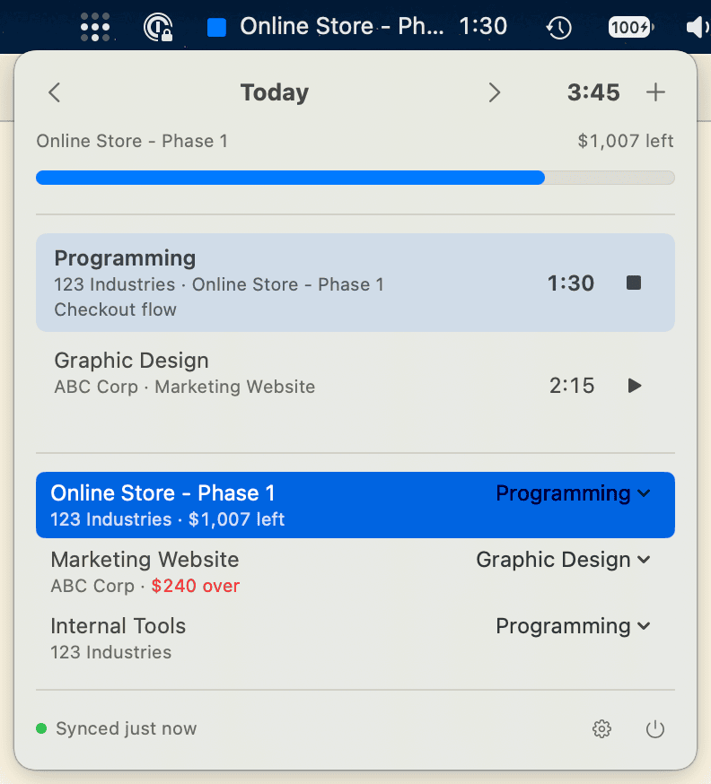
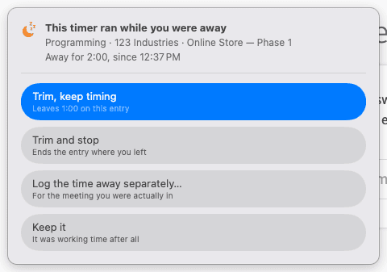

# Sheaves

[](https://github.com/rainhead/sheaves/actions/workflows/build.yml)

A native SwiftUI menu bar client for [Harvest](https://www.getharvest.com) time tracking.

It notices when a timer has been running with nobody at the Mac and offers to trim
the time — and it knows that being on a call is not being away, so it stays quiet
through Zoom and Meet. The clock you are on is always visible in the menu bar,
⌃⌥⌘T starts a timer from anywhere, and nothing blocks on the network: Sheaves shows
local state immediately and reconciles with Harvest afterwards.



## Status

Early. The macOS app tracks time, and a GNOME app is being built beside it on the
same Rust core ([the plan](docs/gnome-port.md)): it starts and stops timers and
shows the running one in the top bar, asks about time away as the Mac does, and
edits entries as the Mac does: their notes, time, project and task, and time
logged without a timer.
iOS is not built.

It was built for one person's use, which is why it does what it does and no more.
**If this is interesting to you, please get in touch** —
[open an issue](https://github.com/rainhead/sheaves/issues) and say hello. Interest is
also what decides the signing question below: a Developer ID needs the paid Apple
Developer Program membership described under [Building it](#building-it), and paying
for distribution before anyone else wants the app is the wrong order.

## Installing

Download the newest zip from [Releases](https://github.com/rainhead/sheaves/releases),
unpack it, and move `Sheaves.app` to `/Applications`.

macOS will refuse to open it. Releases are signed *ad-hoc* rather than with a
Developer ID, and Gatekeeper does not accept an ad-hoc signature from the internet —
so it has to be told, once, that this one is wanted:

```sh
xattr -dr com.apple.quarantine /Applications/Sheaves.app
```

An ad-hoc signature also changes with every build, so macOS treats each release as a
different app and asks again for Keychain access to your Harvest token. Both costs go
away with a Developer ID certificate and notarisation, which is a paid membership and
therefore waiting on the paragraph above.

## Building it

Requires Xcode 26 or later and [rustup](https://rustup.rs), which installs the Rust
compiler that [`rust-toolchain.toml`](rust-toolchain.toml) names on first use. The
core is Rust so a GNOME app can share it; the plan for that app is
[`docs/gnome-port.md`](docs/gnome-port.md).

```sh
brew install xcodegen          # the .xcodeproj is generated, not committed
Scripts/build-xcframework.sh   # the Rust core, built into the Swift package
xcodegen generate
open Sheaves.xcodeproj
```

Xcode does not rebuild the Rust core, so rerun the script after changing anything
under `crates/`. `make build` and `make test` run it for you.

The project signs ad-hoc, so a fresh checkout builds and runs with no Apple
Developer account. The catch is that an ad-hoc signature changes with every build,
so macOS treats each rebuild as a different app and re-prompts for the Keychain item
holding your token. To stop that, copy
[`Config/Local.example.xcconfig`](Config/Local.example.xcconfig) to
`Config/Local.xcconfig` (git-ignored) and fill in your team ID. A **free** Apple ID
is enough — the $99 Developer Program is for distribution, not for running your own
app on your own Mac.

```sh
cargo test                                                  # core logic
swift test --package-path Packages/SheavesCore              # bindings, Keychain, formatting
xcodebuild -project Sheaves.xcodeproj -scheme Sheaves \
  -destination 'platform=macOS' test                        # app logic
```

The core suite is the bulk of it. The app suite exists because the parts that only
compile against AppKit had no tests at all, and that is where the worst bugs turned
up — a shortcut recorder that trapped on every key press, and a missing main menu
that made ⌘V silently do nothing.

### On GNOME

Requires GTK 4, libadwaita and rustup. There is no package; build from the checkout
and run.

```sh
sudo apt install libgtk-4-dev libadwaita-1-dev   # Ubuntu 26.04
cargo run --release -p sheaves-gnome
cargo test -p sheaves-gnome
```

The running timer shows in the top bar through Ubuntu's AppIndicator extension,
which is on by default there; elsewhere, install that extension. Each launch
installs a desktop entry and icon into `~/.local/share`, pointing at the binary
where it is, so GNOME knows the window and the app grid lists it. Settings has a
switch to start at login. The token is kept in the keyring.

A release is cut by bumping `MARKETING_VERSION` in [`project.yml`](project.yml) and
pushing a matching `v` tag.
[`Scripts/package-release.sh`](Scripts/package-release.sh) builds and zips the app,
and [the release workflow](.github/workflows/release.yml) runs that same script after
the tests pass — refusing any tag that disagrees with the version the built app
reports.

## Connecting to Harvest

Create a personal access token at
[id.getharvest.com/developers](https://id.getharvest.com/developers) and paste it,
with the account ID shown beside it, into Sheaves' settings. The token is stored in
the Keychain and sent only to `api.harvestapp.com`.

Settings has a switch to open Sheaves at login, which registers the bundle where it
sits right now — move the app and the switch has to go off and on again to point at
the new location.

## How it works

Three ideas carry most of the design.

**A day is not a moment.** Harvest's `spent_date` is a date with no time zone, and
round-tripping it through `Date` puts entries on the wrong day for anyone east or
west of wherever the conversion happened. [`CalendarDate`](crates/sheaves-core/src/calendar_date.rs)
keeps days as days and only becomes a `Date` against an explicit calendar.

**Time is recorded, not re-measured.** Harvest's `/stop` banks time up to the moment
the request *arrives*, and a create starts its timer on arrival too — so replaying
bare commands after a spell offline destroys or invents hours in equal measure. Every
[`Mutation`](crates/sheaves-core/src/queue.rs) that
affects elapsed time carries the time the user acted and sends explicit hours, so an
entry is honest however late the request lands.

**Local state is the truth until a sync succeeds.** Every action — start, stop,
resume, edit — changes [`TimeTracker`](crates/sheaves-core/src/tracker.rs)
first and reaches Harvest second, through a persisted
[`MutationQueue`](crates/sheaves-core/src/queue.rs).
The queue drains in order and stops at the first failure a retry could fix, so a
dropped connection costs nothing; a change Harvest refuses outright is dropped rather
than left to wedge everything behind it. An entry started offline has no Harvest id
yet, which is why [`TrackedEntry`](crates/sheaves-core/src/tracked_entry.rs)
identity is either a server id or a local one, swapped when the create lands. The
queue remembers which account and user filled it: a renewed token for the same person
sends what was waiting, and anyone else is asked before it is discarded, never sent.

**Syncing is event-driven, plus a probe for everyone else's edits.** Every action
syncs on the spot, and opening the panel does too — so a background probe exists
only to catch changes made outside this app, like the web timesheet or a phone. Its
cadence follows what the request costs: outside edits land within a minute while
you are working on mains power, an idle machine checks occasionally, a battery
slows both, and Low Power Mode stops the probe entirely. The cadence is
[`probe_interval`](crates/sheaves-core/src/tracker.rs);
the Mac shell answers the power question through
[`PowerSource`](Apps/Mac/Sources/PowerSource.swift).

**The menu bar is a control, not a readout.** The status item shows a pause button
while a timer runs and a play button for 90 minutes after one stops, and
otherwise Sheaves' own glyph, a sheaf of wheat between the plates of an hourglass
([`icons/`](icons)), so the common
action costs one click and opens nothing; clicking the name opens the popover
instead. That is why [`StatusItemController`](Apps/Mac/Sources/StatusItemController.swift)
is hand-rolled AppKit — SwiftUI's `MenuBarExtra` has exactly one behaviour, which is
to open its content on any click. A running timer's glyph is drawn in the accent
colour, the way macOS says a menu bar extra is doing something, and colour is never
the only thing saying it: the three states already have three different symbols.

**Being on a call is not being away.** Idle detection that watches only the
keyboard and mouse interrupts every meeting to ask whether you are still there, and
Harvest's own app does exactly that. Sheaves counts the microphone being in use as
presence — while you are muted too, which is the case that decides whether any of
this is worth having — so a call is time at work like any other. It asks whether a
device is running, never what it is carrying, so it needs no microphone entitlement
and prompts for no permission. A locked screen outranks it, and an absence only
speaks for a timer that was running while somebody was here: one started on the web
or a phone is left alone, because this Mac knows nothing about it.
[How Sheaves decides you are here](docs/presence.md) has the measurements and the
limits.

**Two machines agree about when you were away.** Start a timer on the Mac, work at
another machine for two hours, come back, and the Mac alone would offer to trim two
hours of real work. So each instance keeps a day's log of when it saw you, writes
the part since the timer started onto the running entry in Harvest, and before
asking about an absence reads what the other machines wrote there. Nothing needs
setting up: every machine signed in to the same Harvest account takes part. A
question answered on one machine goes away on the other when that one next looks
at Harvest: within a minute plugged in, five on battery, and at its next sync in
Low Power Mode, which stops the regular checks. A stop reads the entry back before
sending its hours, so a trim made on the other machine is not overwritten. What is
written, and why on the entry, is in [How Sheaves decides you are
here](docs/presence.md#other-machines).



**Suggestions are ranked by what you actually do.** Harvest returns every task on
every assigned project, alphabetically, burying the two or three things you do daily.
Sheaves ranks them by 90 days of your own entries, weighted so the score halves every
three weeks: frequency alone pins a finished project to the top for weeks, recency
alone lets one stray entry outrank a habit.

**A budget appears only if there is one.** Harvest's project budget report answers
`budget_by: none` for a project that budgets nothing, and empty figures for a
monetary budget, which only administrators and managers holding the billable-rates
permission may read. On some accounts there is nothing to draw, and there is no
lesser version to fall back on — so
[`BudgetBar`](Apps/Mac/Sources/BudgetBar.swift) is absent rather than present and
empty, and a refusal is taken as a settled answer rather than retried. It is also
the one thing here on Harvest's Reports API, whose allowance is 100 requests per 15
*minutes* rather than per 15 seconds, so budgets refresh on a slow clock of their
own instead of riding every start and stop.

**The UI never waits to draw.** A JSON
[snapshot](crates/sheaves-core/src/snapshot.rs)
of the last known state is restored at launch, so the popover is populated before the
first request returns.

The global hotkey uses Carbon's `RegisterEventHotKey`
([`GlobalHotKey`](Apps/Mac/Sources/GlobalHotKey.swift)) rather than an `NSEvent`
monitor: it needs no Accessibility permission and can actually consume the key. It is
rebindable in Settings, and says so when another app already owns the combination —
Carbon reports that by failing silently, which is worth surfacing.

## Layout

| Path | What lives there |
| --- | --- |
| [`crates/sheaves-core`](crates/sheaves-core) | Everything but the views: the API client, models, the queue, the tracker, presence, and how it is shared between machines. Rust, so a GNOME app can share it. |
| [`Packages/SheavesCore`](Packages/SheavesCore) | The core as Swift sees it: the [UniFFI](https://mozilla.github.io/uniffi-rs/) bindings, an `@Observable` wrapper, the Keychain, and formatting. |
| [`Apps/Mac`](Apps/Mac) | The menu bar app: popover, quick-entry panel, settings. |
| [`crates/sheaves-gnome`](crates/sheaves-gnome) | The GNOME app: the running timer in the top bar, the day in a libadwaita window. |
| [`project.yml`](project.yml) | Targets and build settings; the `.xcodeproj` is generated from it. |
| [`Scripts`](Scripts) | Jobs that need more than a line: the Rust core for the Mac, the release package, the documentation images. |
| [`docs`](docs) | Notes too long for here, and the images this file uses. |

## Keyboard

| | |
| --- | --- |
| ⌃⌥⌘T | Quick entry, from any app (rebindable in Settings) |
| Click ⏸ / ▶ in the menu bar | Pause or resume, without opening anything |
| ↑ ↓ | Move through the day's entries and the projects, as one list |
| ⏎ | Stop or resume the selected entry, or start the selected project |
| ⌫ | Delete the selected entry, after asking |
| Right-click an entry | Edit its notes or time, or delete it |
| ⌘← ⌘→ | Previous / next day |

## Licence

MIT. See [LICENSE](LICENSE).
